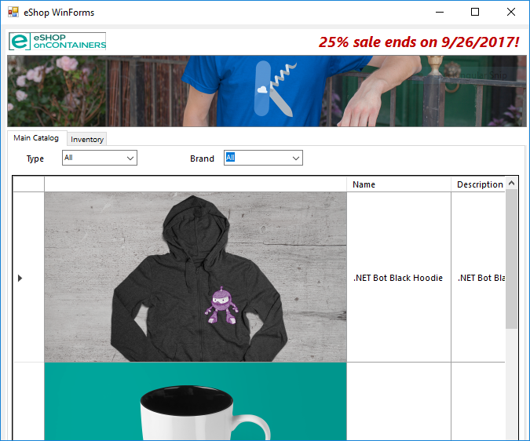

# eShopLegacyNTier: legacy WCF + WinForms app

The N-Tier catalog app from Microsoft's
[dotnet-architecture/eShopModernizing](https://github.com/dotnet-architecture/eShopModernizing)
(MIT licensed, archived), on its own: a WinForms client that calls a WCF service backed by
SQL Server. It is a starting point for Moderne demos that migrate .NET Framework code to
modern .NET with OpenRewrite recipes and agents.

## What's included

| Solution | Project | Framework |
|---|---|---|
| `eShopLegacyNTier` | `eShopWCFService`: WCF service, EF6 | 4.6.1 |
| | `eShopWinForms`: WinForms client | 4.7 |

## What's removed

Everything else in the upstream repo: the MVC and Web Forms apps, the modernized and ported
copies (`eShopModernized*`, `eShopPorted`), and the container, Kubernetes, Azure and
Service Fabric material. The content matches upstream `main` at
[`63bc9ec`](https://github.com/dotnet-architecture/eShopModernizing/commit/63bc9ec4414d7e281dc9f9d7bdcf70030950457d)
apart from those removals, this README and `eShopLegacyNTier/nuget.config`, which restores
packages to `src/packages` where the projects expect them (upstream's solution does not build
from a clean clone without it). Upstream history is not included.

## Running the app

Open `eShopLegacyNTier/eShopLegacyNTier.sln` in Visual Studio on Windows. The WCF service
uses SQL Server LocalDB (`EntityModel` in its `Web.config`), and the client expects the
service at `http://localhost:62314/CatalogService.svc`.

## Branches

`main` is the baseline and does not change.
